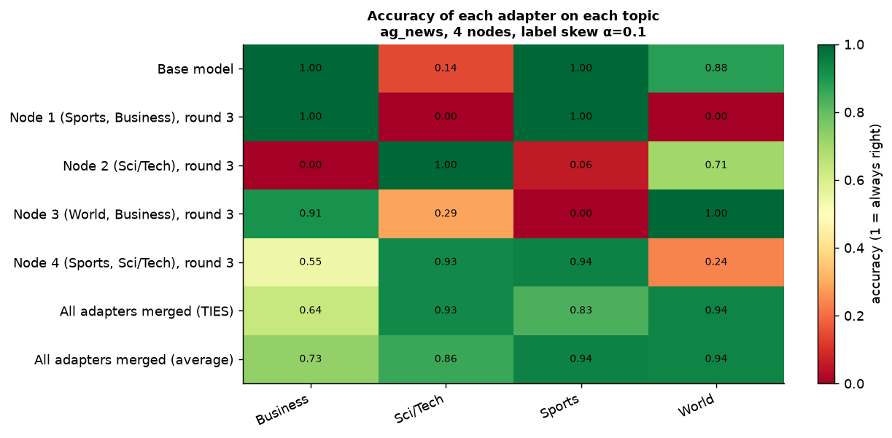
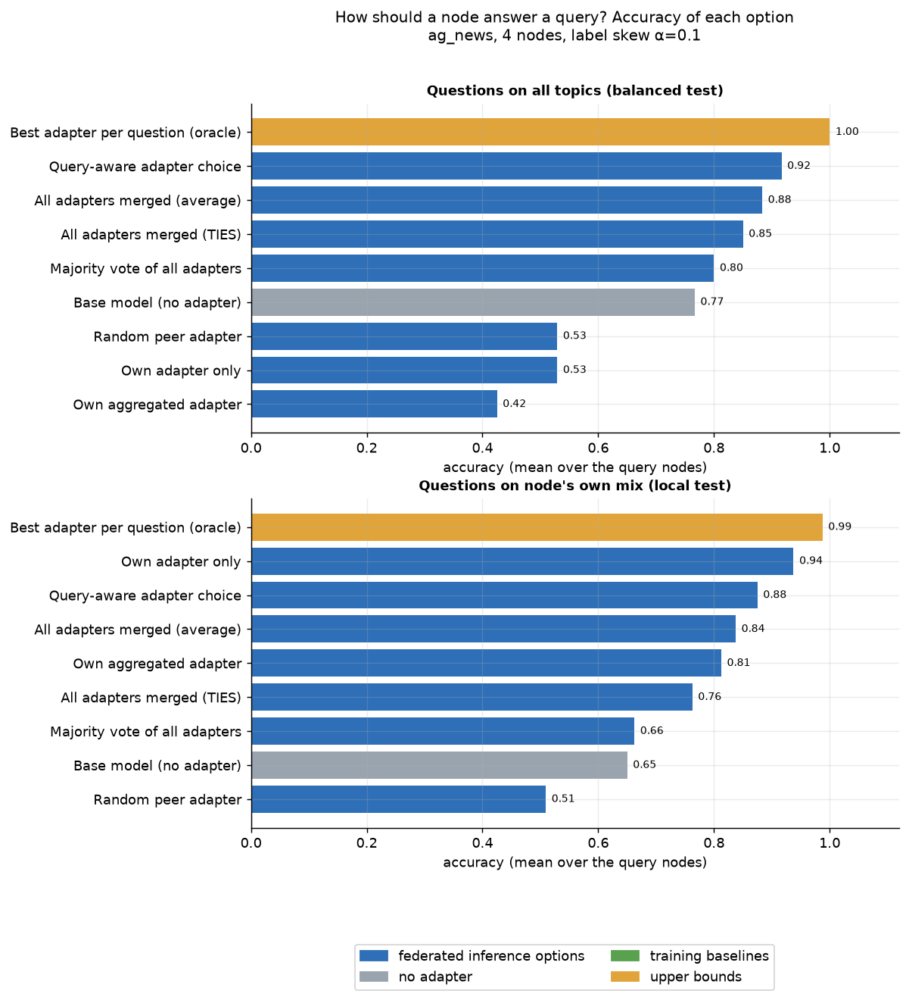
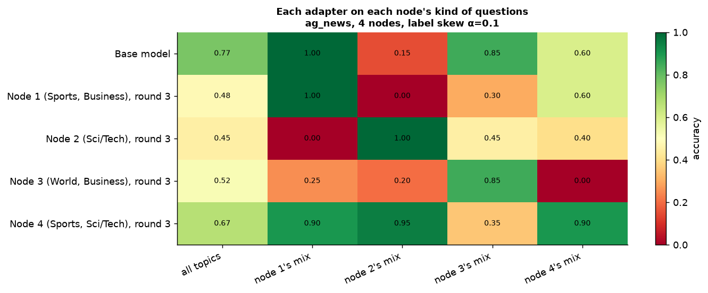
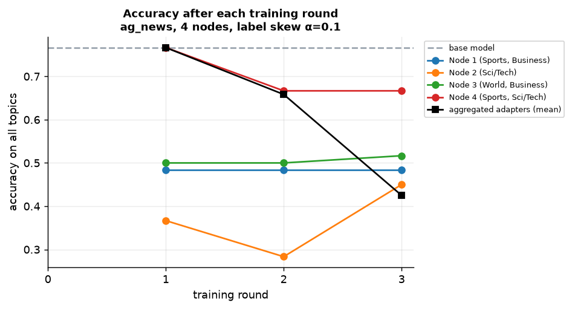

# Results: ag_news, 4 nodes, label skew α=0.1, seed 0

Folders: `figures/` (PNG + PDF), `tables/` (the numbers behind every figure, CSV), `raw/` (one row per question or request).

## Each node's adapter is good only at the topics it trained on

**How to read it.** Rows are adapters (the node and the topics most of its training data came from), columns are topics, cells are the share of questions answered correctly on a test set with equal numbers of each topic. Green = right, red = wrong.

**What this run shows.** Node adapters score 1.00 on their own topics but as low as 0.00 on topics they never saw; the base model ranges 0.14-1.00 across topics. No single node's adapter is good at everything, which is why a node should be able to use a peer's adapter.
Table: `tables/accuracy_per_topic.csv`

## Choosing the adapter per question beats using your own adapter

**How to read it.** Each bar is one way for a node to answer: blue = options of our federated inference (own adapter, a random peer's, the adapter whose training data looks most like the question, all adapters merged, majority vote), grey = base model, green = training baselines, orange = upper bounds (oracle, centralised training on pooled data, which is not private). Left: questions on all topics; right: questions with the node's own topic mix.

**What this run shows.** On all topics, own adapter only = 0.53, base model = 0.77, query-aware choice = 0.92, merged = 0.88, oracle = 1.00. On the node's own mix its own adapter is strong (0.94). Using peers' adapters fixes the topics a node never trained on.
Table: `tables/accuracy_by_selection_method.csv`

## An adapter is best on its own node's questions

**How to read it.** Rows = adapters, columns = test sets that follow the topic mix of one node (plus all topics). The diagonal (a node's adapter on its own kind of questions) should be green.

**What this run shows.** The diagonal is high and many off-diagonal cells are low: the best adapter depends on who is asking what.
Table: `tables/accuracy_adapter_vs_test_set.csv`

## Adapters specialise further with every round

**How to read it.** Accuracy on all topics of each node's adapter after rounds 1-3. Dashed = base model.

**What this run shows.** After the last round, node adapters score 0.45-0.67 on all topics (base model 0.77).
Table: `tables/accuracy_by_round.csv`
