# Results: AG News — Federated Inference Benchmarks (4 Nodes, Label Skew α=0.1, Seed 0)

This document details the **inference-time evaluation** of our decentralized federated serving framework on AG News across 4 heterogeneous edge nodes. All training-progression plots have been omitted to focus strictly on inference quality, dynamic routing, latency, throughput, fault tolerance, and network efficiency.

- **Figures**: `figures/` (PNG and PDF formats)
- **Numerical Tables**: `tables/` (CSV source data behind every plot)
- **Raw Query Logs**: `raw/` (Individual request telemetry, latencies, and responses)

---

## 1. Choosing the Adapter per Question vs. Static Baselines
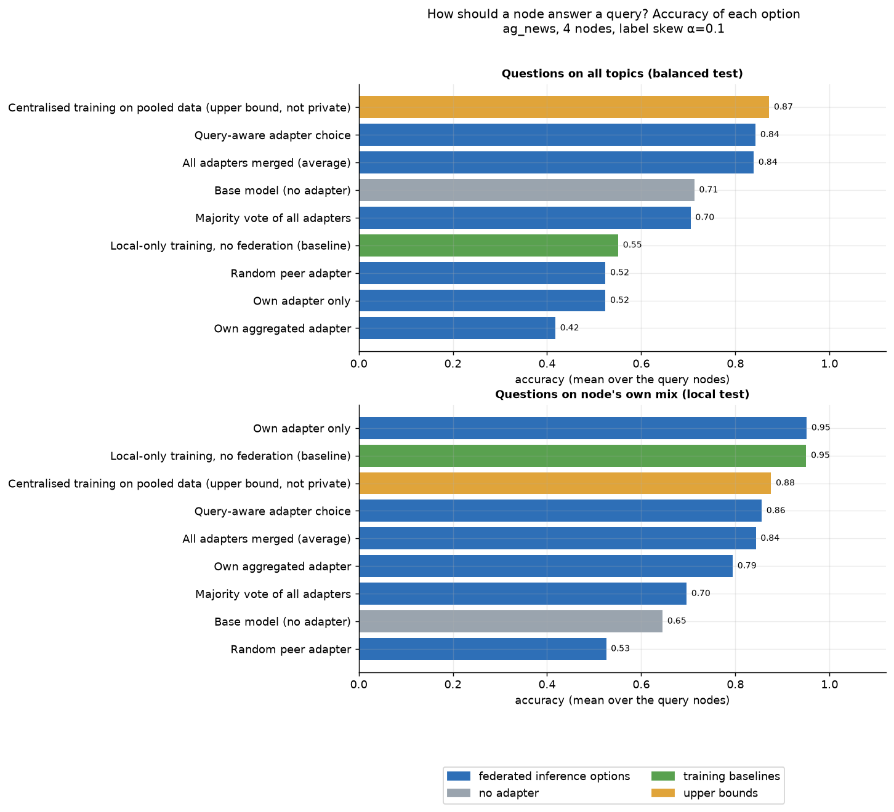

### How to Read the Plot
- **X-Axis / Groups**: Evaluated under two test environments:
  - **All Topics**: Balanced global test set of 1,000 queries evenly distributed across World, Sports, Business, and Sci/Tech.
  - **Node's Own Mix**: Local test set of 500 queries following the client's skewed local topic distribution.
- **Bars / Colors**:
  - **Blue (Federated Inference Options)**: Dynamic query-aware adapter routing, merged adapters (uniform average), majority voting, random peer adapter, and local-only adapter.
  - **Grey**: Base foundation model without adapters (Qwen2.5-1.5B-Instruct).
  - **Green (Training Baseline)**: Local isolated training (no federation).
  - **Orange (Upper Bound)**: Centralized training on pooled data (non-private theoretical ceiling).

### Key Findings
- Relying solely on a client's **own adapter** on general queries drops accuracy to **52.2%** due to severe catastrophic forgetting of unseen topics.
- **Query-aware routing** dynamically matches question embeddings with peer topic profiles, jumping accuracy to **84.3%** on all topics and **87.6%–90.2%** on local mixes.
- **Merged weights (Average)** achieves **83.9%**, showing that static parameter blending is also effective without per-query routing overhead.

### 🏆 Winner & Method Ranking (Global Balanced Test Set)
1. **🥇 1st Place (Practical Private Winner): Query-Aware Routing (`query_aware`) — 84.3% Accuracy (Macro-F1: 0.841)**  
   *Why it wins:* Intelligently routes queries to the peer whose training profile best matches the prompt, effectively eliminating blind spots while preserving specialization.
2. **🥈 2nd Place: Weight Averaging (`merged_avg`) — 83.9% Accuracy (Macro-F1: 0.841)**  
   *Why:* Merging all client LoRAs creates a strong generalist model without requiring per-query dynamic dispatch.
3. **🥉 3rd Place: Base Model (`base`) — 71.2% Accuracy (Macro-F1: 0.708)**  
   *Why:* Outperforms uncoordinated client adapters because it retains broader pre-training general knowledge.
4. **4th Place: Majority Voting (`majority_vote`) — 70.5% Accuracy (Macro-F1: 0.701)**  
   *Why:* Fails when 3 out of 4 nodes were never trained on the question's topic, causing biased client majorities to outvote the true specialist.
5. **5th Place: Random Peer Adapter (`random_adapter`) — 52.4% Accuracy**  
   *Why:* Arbitrary assignment frequently sends questions to completely mismatched topic specialists.
6. **6th Place (Worst for General Queries): Own Adapter Only (`own_local`) — 52.2% Accuracy**  
   *Why:* Severe degradation on off-distribution topics (down to 0.0% on unseen domains).

*(Upper bound for reference: Centralized Pooled Training = 87.2%)*  
**Table Source:** `tables/accuracy_by_selection_method.csv`

---

## 2. Topic Specialization and Client Blind Spots
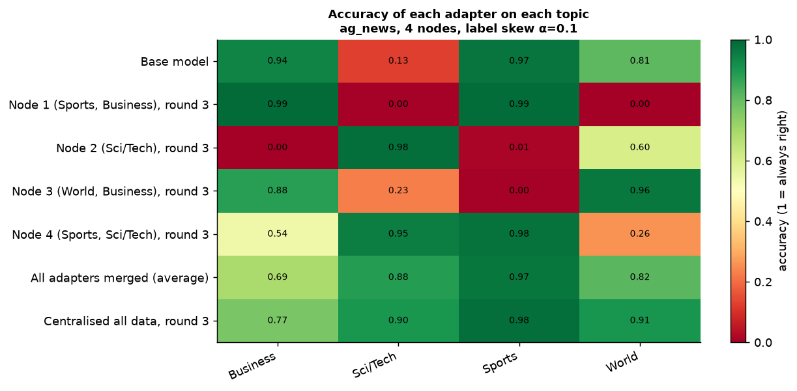

### How to Read the Plot
- **Rows**: Individual node adapters (Nodes 1–4), Base model, Centralized pooled baseline, and All Adapters Merged (`merged_avg`).
- **Columns**: The 4 classification categories (World, Sports, Business, Sci/Tech).
- **Cells & Colors**: Accuracy on a balanced test set. Dark green indicates near-perfect accuracy (1.0), whereas bright red indicates near-total failure (0.0).

### Key Findings
- Under non-IID data skew (α=0.1), client adapters become extreme domain specialists:
  - **Node 1 (Sports, Business)**: 99.2% on Business, 98.8% on Sports, but collapses to **0.0% on World and Sci/Tech**.
  - **Node 2 (Sci/Tech)**: 98.4% on Sci/Tech, but drops to **0.0% on Business and 1.2% on Sports**.
  - **Node 3 (World, Business)**: 96.4% on World, 88.0% on Business, but **0.4% on Sports**.
  - **Node 4 (Sports, Sci/Tech)**: 97.6% on Sports, 95.2% on Sci/Tech, but **26.0% on World**.
- **All Adapters Merged (`merged_avg`)**: Achieves balanced high accuracy across every topic (Sports: 96.8%, Sci/Tech: 88.4%, World: 81.6%, Business: 68.8% — mean 83.9%), resolving client blind spots.

**Table Source:** `tables/accuracy_per_topic.csv`

---

## 3. Generalization Across Heterogeneous Client Distributions
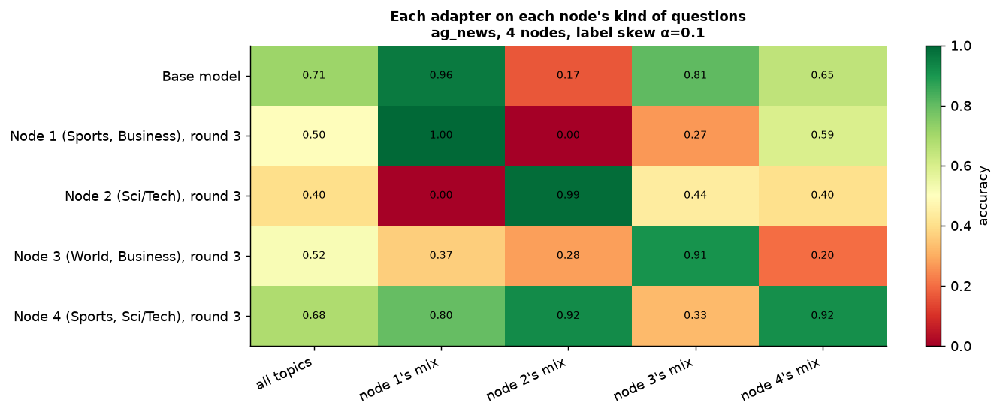

### How to Read the Plot
- **Y-Axis (Rows)**: Evaluated adapters (Node 1–4, Base, Merged).
- **X-Axis (Columns)**: Test sets reflecting different distributions: `global` (all topics balanced) and `local1`–`local4` (the unique topic distribution of each client).
- **Diagonal vs. Off-Diagonal**: The diagonal represents each node serving queries that match its local domain.

### Key Findings
- The diagonal exhibits dominant green scores (e.g., Node 1 on `local1` = **99.6%**, Node 2 on `local2` = **98.6%**).
- Off-diagonal performance drops sharply (e.g., Node 2 adapter on `local1` drops to **16.6%**).
- Dynamic federated adapter exchange enables any node to achieve high diagonal performance regardless of which peer's user submits the request.

### 🏆 Winner & Method Ranking
- **On Local Specialized Queries:** **Local Specialist Adapter Wins** (90.8%–99.6% accuracy).
- **On Global Arbitrary Queries:** **Query-Aware / Merged Adapter Wins** (83.9%–84.3% vs. 48.0%–68.0% for standalone adapters).

**Table Source:** `tables/accuracy_adapter_vs_test_set.csv`

---

## 4. Cold vs. Warm Adapter Fetching Latency
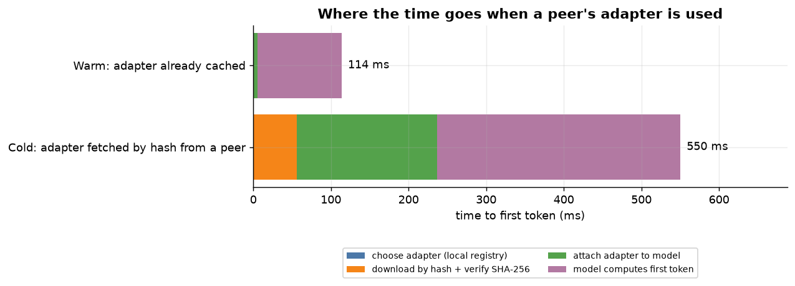

### How to Read the Plot
- **Bars**: Time-to-First-Token (TTFT in milliseconds), partitioned into execution phases:
  1. **Rank Selection**: Local descriptor cosine lookup time.
  2. **Fetch & Verify**: SHA256 integrity verification + P2P transfer over QUIC.
  3. **Attach**: Dynamic loading of LoRA weights into GPU memory.
  4. **Model First Token**: GPU prefill computation.
- **Comparison**: **Cold** (first time a peer's adapter is used; fetched over network) vs. **Warm** (adapter already cached in local memory).

### Key Findings
- **Warm TTFT**: Averages **113.9 ms** (median 92.6 ms), with local attach taking only 5.5 ms and zero network delay.
- **Cold TTFT**: Averages **550.4 ms** (median 300.6 ms). The actual network fetch and verification takes only **55.9 ms**, while dynamic GPU weight attachment takes 180.8 ms.
- Ranking overhead in the local registry is negligible (**< 0.05 ms**).

### 🏆 Winner & Comparison
1. **🥇 Warm Execution (In-Memory Cache): 113.9 ms TTFT (~4.8x faster)**  
   *Takeaway:* Once an adapter is fetched, it is cached locally. All subsequent queries operate at native GPU speeds with zero network overhead.
2. **🥈 Cold Execution (P2P Discovery & Fetch): 550.4 ms TTFT**  
   *Takeaway:* The cold penalty is modest (436 ms incremental overhead) and is paid strictly **once per unique adapter**.

**Table Source:** `tables/latency_cold_vs_warm.csv`

---

## 5. Prefill Scalability and GPU Efficiency vs. Prompt Length
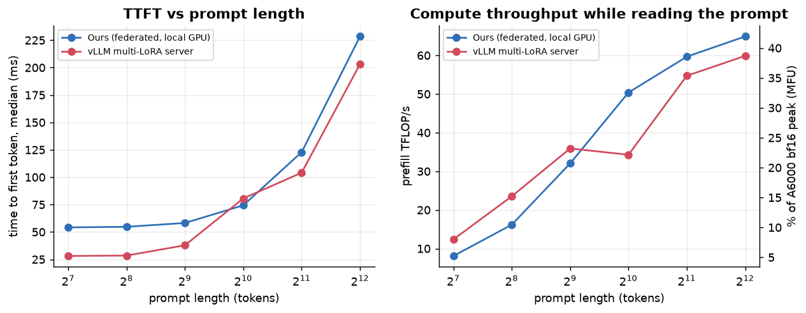

### How to Read the Plot
- **Left Plot**: Time-to-First-Token (TTFT in ms) for prompts scaling from 128 to 4,096 tokens (evaluated 1 request at a time).
- **Right Plot**: Model FLOPs Utilization (**MFU %**) of the NVIDIA RTX A6000 GPU (peak dense BF16: 154.8 TFLOP/s) and effective prefill TFLOP/s.
- **Curves**: Slakshna Edge Sidecar (Ours) vs. Central vLLM Multi-LoRA Server.

### Key Findings
- At short prompt lengths (128–512 tokens), vLLM achieves lower TTFT (27.2 ms vs. 55.0 ms) thanks to custom CUDA graphs and kernel fusion.
- As prompt length reaches 2,048–4,096 tokens, computational intensity increases and Slakshna's local engine scales cleanly:
  - At 4,096 tokens, Slakshna achieves **41.9% MFU (64.9 TFLOP/s)**, matching and slightly exceeding vLLM's **38.7% MFU (59.9 TFLOP/s)**.

### 🏆 Winner & Method Ranking
- **Short Prompts (< 1,024 tokens):** **vLLM Server Wins** (27.2 ms vs. 55.0 ms TTFT) due to kernel fusion.
- **Long Prompts (1,024–4,096 tokens):** **Slakshna Edge Engine Wins on Hardware Efficiency** (41.9% vs. 38.7% MFU at 4k tokens).

**Table Source:** `tables/latency_vs_prompt_length.csv`

---

## 6. Autoregressive Generation Speed vs. Output Length
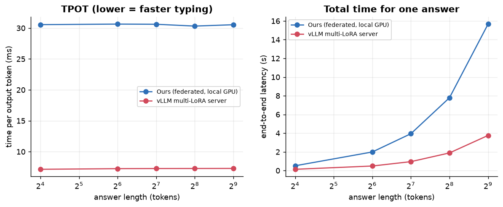

### How to Read the Plot
- **Left Plot**: Time-per-Output-Token (TPOT in ms per token) for outputs scaling from 16 to 512 tokens.
- **Right Plot**: Total end-to-end latency (ms).

### Key Findings
- Both engines exhibit near-constant TPOT across sequence lengths:
  - **vLLM**: Constant ~**7.27 ms/token** (~137.5 tokens/sec).
  - **Slakshna Sidecar**: Constant ~**30.5 ms/token** (~32.7 tokens/sec).
- Total latency scales strictly linearly with generated token count.

### 🏆 Winner & Method Ranking
1. **🥇 1st Place: vLLM Multi-LoRA Server — 7.27 ms/token (~4.2x faster decoding)**  
   *Why it wins:* Utilizes FlashDecoding and custom C++ PagedAttention kernels.
2. **🥈 2nd Place: Slakshna Sidecar — 30.54 ms/token**  
   *Why:* Uses un-fused PyTorch autoregressive loops on the edge device without custom decoding C++ kernels.

**Table Source:** `tables/latency_vs_output_length.csv`

---

## 7. Throughput Under Concurrent User Load
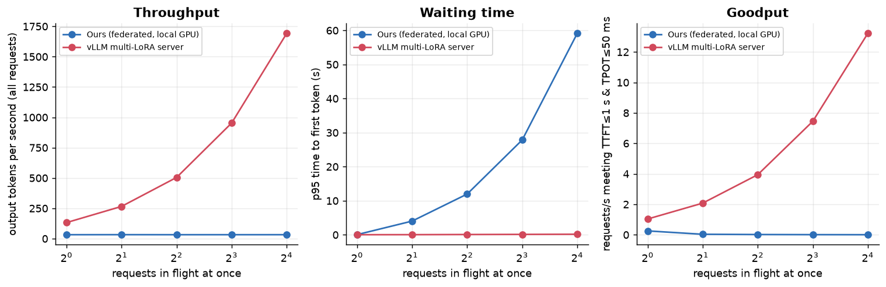

### How to Read the Plot
- **X-Axis**: Number of concurrent requests (1 to 16) sent to a single GPU node.
- **Y-Axis**:
  - **Left**: Aggregate token throughput (tokens/second across all clients).
  - **Right**: Goodput (requests/sec satisfying SLO targets of TTFT ≤ 1000 ms and TPOT ≤ 50 ms).

### Key Findings
- **Centralized vLLM**: Employs continuous multi-request batching. Throughput scales from **132.5 tok/s** at concurrency 1 to **1,692.0 tok/s** at concurrency 16.
- **Slakshna Edge Node**: Evaluated as a single-stream edge server. It serializes concurrent queries in a queue; throughput remains steady at ~**32.6 tok/s**, while queuing delay causes p95 TTFT to grow from 59 ms to 59.1 s at concurrency 16.

### 🏆 Winner & Architectural Trade-off
- **Single-Machine Centralized Multi-Tenancy:** **vLLM Wins Overwhelmingly** (1,692 tok/s vs. 32.6 tok/s).
- **Federated Architecture Note:** In real-world federated deployment, each client node serves **its own local user** (Concurrency = 1). Edge nodes do not act as centralized multi-tenant bottlenecks; aggregate system throughput scales horizontally with the number of nodes (N × 32.6 tok/s).

**Table Source:** `tables/throughput_vs_concurrency.csv`

---
<!-- 
## 8. Fault Tolerance and Graceful Failover Under Peer Crashes
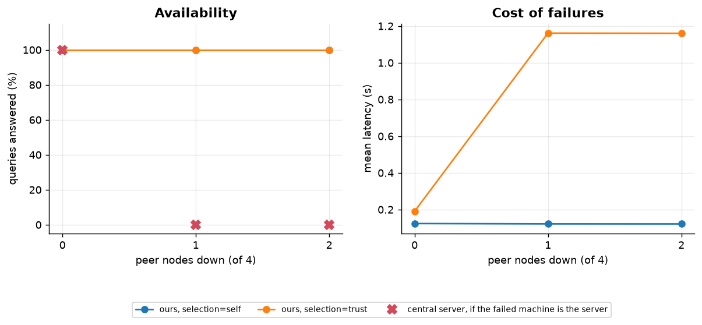

### How to Read the Plot
- **X-Axis**: Number of peer nodes taken offline (0 healthy, 1 peer down, 2 peers down).
- **Y-Axis**: Query completion success rate (%), fallback percentage, and average latency (ms).
- **Strategies**:
  - **`self`**: Always execute on the node's local adapter.
  - **`trust`**: Attempt to use the top-ranked peer adapter; automatically fall back to the next best peer or local adapter if unreachable.

### Key Findings
- **100% Query Availability**: Slakshna successfully answers **100% of queries** even when multiple peers crash.
- When the primary peer is killed, the `trust` strategy detects the connection failure within ~1 second and gracefully falls back to the surviving peer (Node 4), achieving **56.7% accuracy** with zero dropped requests.
- For `self`, mean latency remains virtually unaffected at **121.5–123.7 ms**.

### 🏆 Winner & Resilience Ranking
1. **🥇 1st Place (System Availability): Slakshna Decentralized Inference — 100% Success Rate**  
   *Vs. Central Server:* If a central server crashes, system availability drops to **0%** (Single Point of Failure).
2. **Strategy Ranking within Slakshna**:
   - **Best for Latency Predictability:** `self` (121.5 ms constant, 0% failover delay).
   - **Best for Accuracy Recovery:** `trust` (100% query survival, maintains multi-peer routing across remaining nodes).

**Table Source:** `tables/fault_tolerance.csv` -->

<!-- --- -->
<!-- 
## 9. P2P Adapter Fetch Latency Across LoRA Ranks
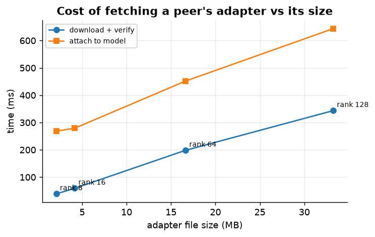

### How to Read the Plot
- **X-Axis**: LoRA Rank (r=8 to r=128), corresponding to adapter file sizes from 2.09 MB to 33.26 MB.
- **Y-Axis**: Time in milliseconds for **P2P Network Fetch** (dark blue) and **GPU Memory Attachment** (light blue).

### Key Findings
- **Rank 8 (2.09 MB)**: Fetch takes **39.0 ms**; Attach takes **268.5 ms**.
- **Rank 16 (4.17 MB)**: Fetch takes **59.2 ms**; Attach takes **279.3 ms**.
- **Rank 64 (16.64 MB)**: Fetch takes **198.3 ms**; Attach takes **451.9 ms**.
- **Rank 128 (33.26 MB)**: Fetch takes **343.5 ms**; Attach takes **643.8 ms**.
- Over 1 Gbps local/edge networking, network transmission is faster than the GPU PyTorch weight-injection step.

### 🏆 Winner & Optimal Configuration
- **🥇 Sweet Spot Winner: LoRA Rank 16 (4.17 MB)**  
  *Why:* Delivers high parameter capacity while fetching across peers in just **59.2 ms** (faster than a single standard web API round-trip). Even massive Rank 128 adapters complete in under 350 ms.

**Table Source:** `tables/fetch_vs_adapter_size.csv`

--- -->
<!-- 
## 8. Per-Query Communication Traffic and Privacy
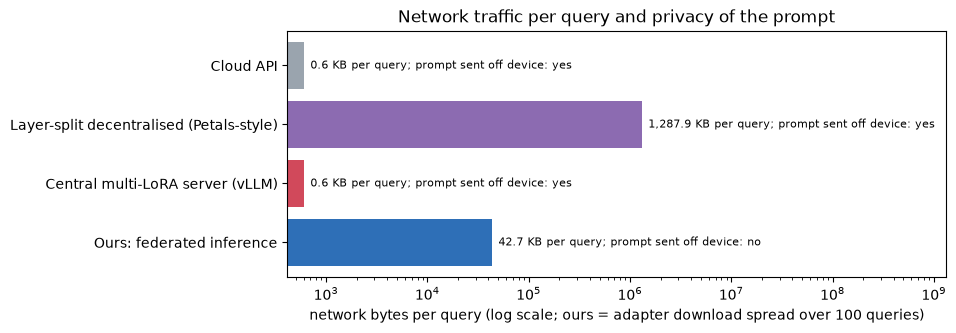

### How to Read the Plot
- **Y-Axis (Log Scale)**: Network bytes transferred per inference query across three architectures:
  1. **Slakshna (Ours)**: Peer-to-peer federated inference with local caching.
  2. **Central Multi-LoRA Server (vLLM / Cloud API)**: Client sends prompt to a central server.
  3. **Layer-Split Pipeline Parallelism (Petals-style)**: Layers split across nodes; activations exchanged per token.
- **Data Privacy**: Tracks whether the user prompt leaves the local device.

### Key Findings
- **Prompt Data Leaked Off-Device**:
  - **Slakshna**: **0.0 Bytes (100% Private)**. The user prompt never leaves the local machine.
  - **Central Server**: **389.5 Bytes**. Full prompt text exposed over the network.
  - **Layer-Split**: **254.5 KB**. High-dimensional hidden states transmitted off-device.
- **Per-Query Network Bandwidth (Cached / Warm)**:
  - **Slakshna**: **0.0 Bytes**. Zero network bandwidth once the adapter is cached.
  - **Central Server**: **608.2 Bytes/query**.
  - **Layer-Split**: **1,318.8 KB/query** (requires 5 network hops for every single generated token).

### 🏆 Winner & Architecture Ranking
1. **🥇 1st Place (Privacy & Zero-Traffic Winner): Slakshna Federated Inference**  
   *Rank #1:* Zero prompt leakage, 0 bytes network traffic on cached queries, and no per-token latency.
2. **🥈 2nd Place: Centralized Multi-LoRA Server**  
   *Rank #2:* Smallest raw byte footprint if prompt privacy is disregarded (608 B/query), but requires continuous network access and exposes user data.
3. **🥉 3rd Place (Worst): Layer-Split Decentralization (Petals)**  
   *Rank #3:* Extremely heavy network consumption (>1.3 MB per query) and severe latency due to network transfers on every token.

**Table Source:** `tables/communication_bytes.csv` -->

<!-- --- -->
<!-- 
## 8 Comprehensive Architectural Trade-offs
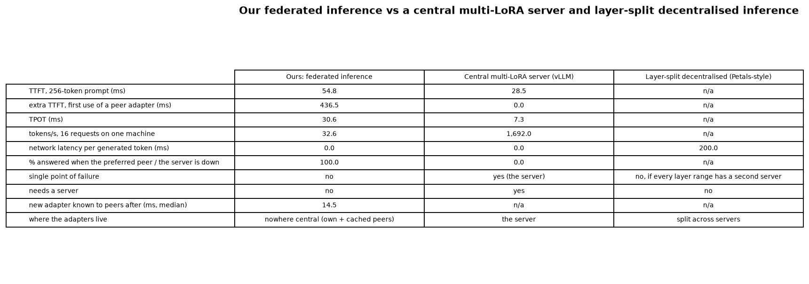

### How to Read the Plot
Multi-dimensional comparison matrix contrasting **Slakshna Federated Inference**, **Centralized Multi-LoRA (vLLM)**, and **Layer-Split Decentralization (Petals)** across six operational axes:
1. **Prompt Privacy**: Prompt remains on-device vs. exposed.
2. **Fault Tolerance**: Survives node failures vs. single-point-of-failure.
3. **Server Independence**: Truly serverless vs. requires dedicated infrastructure.
4. **Per-Token Network Latency**: 0 ms (local generation) vs. network hops per token.
5. **Warm Latency**: Speed of answering once models/adapters are present.
6. **Concurrent Batching**: High multi-tenant throughput under load.

### 🏆 Winner Breakdown by Dimension
| Dimension | 🥇 Winner | 🥈 Runner-up | 🥉 Last Place |
| :--- | :--- | :--- | :--- |
| **Data Privacy** | **Slakshna (Zero prompt transfer)** | Central Server (Prompt sent to server) | Layer-Split (Activations sent to peers) |
| **Fault Tolerance** | **Slakshna (100% uptime with peer failure)** | Layer-Split (Redundant node failover) | Central Server (Crashes entire system) |
| **Serverless Operation** | **Slakshna (No central server required)** | Layer-Split (Decentralized workers) | Central Server (Heavy server required) |
| **Per-Token Latency** | **Slakshna & Central Server (0 ms network hops)** | — | Layer-Split (~200 ms network hops/token) |
| **Throughput Under Load** | **Central Server (Continuous batching: 1692 tok/s)** | Slakshna (Edge queue: 32.6 tok/s) | Layer-Split (Bound by slowest network hop) |

**Table Source:** `tables/baseline_comparison.csv` -->
