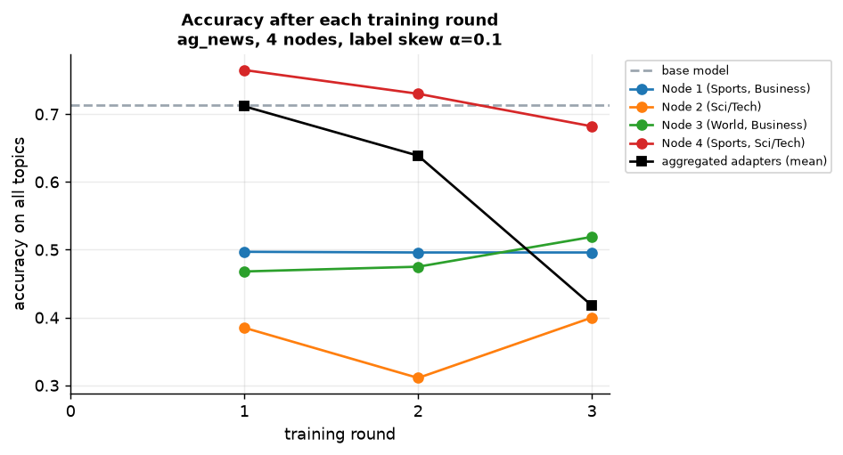

# Results: ag_news, 4 nodes, label skew α=0.1, seed 0

Folders: `figures/` (PNG + PDF), `tables/` (the numbers behind every figure, CSV), `raw/` (one row per question or request).

## Each node's adapter is good only at the topics it trained on

**How to read it.** Rows are adapters (the node and the topics most of its training data came from), columns are topics, cells are the share of questions answered correctly on a test set with equal numbers of each topic. Green = right, red = wrong.

**What this run shows.** Node adapters score 0.99 on their own topics but as low as 0.00 on topics they never saw; the base model ranges 0.13-0.97 across topics. No single node's adapter is good at everything, which is why a node should be able to use a peer's adapter.
Table: `tables/accuracy_per_topic.csv`

## Choosing the adapter per question beats using your own adapter

**How to read it.** Each bar is one way for a node to answer: blue = options of our federated inference (own adapter, a random peer's, the adapter whose training data looks most like the question, all adapters merged, majority vote), grey = base model, green = training baselines, orange = upper bounds (oracle, centralised training on pooled data, which is not private). Left: questions on all topics; right: questions with the node's own topic mix.

**What this run shows.** On all topics, own adapter only = 0.52, base model = 0.71, query-aware choice = 0.84, merged = 0.84, oracle = 0.99. On the node's own mix its own adapter is strong (0.95). Using peers' adapters fixes the topics a node never trained on.
Table: `tables/accuracy_by_selection_method.csv`

## An adapter is best on its own node's questions

**How to read it.** Rows = adapters, columns = test sets that follow the topic mix of one node (plus all topics). The diagonal (a node's adapter on its own kind of questions) should be green.

**What this run shows.** The diagonal is high and many off-diagonal cells are low: the best adapter depends on who is asking what.
Table: `tables/accuracy_adapter_vs_test_set.csv`

## Accuracy of each node's adapter across rounds

**How to read it.** Accuracy on all topics of each node's adapter after rounds 1-3. Dashed = base model.

**What this run shows.** After the last round, node adapters score 0.40-0.68 on all topics (base model 0.71).
Table: `tables/accuracy_by_round.csv`

## Using a peer's adapter costs extra time only the first time

**How to read it.** Time to first token (TTFT) split into its steps. Cold = the adapter is not on this node yet and is downloaded from the peer by its hash; warm = it is already cached.

**What this run shows.** Cold TTFT 550 ms (download+verify 56 ms, attach 181 ms) vs warm 114 ms. Choosing the adapter from the local registry takes under 1 ms because no network call is needed.
Table: `tables/latency_cold_vs_warm.csv`

## Longer prompts: time to first token and GPU efficiency

**How to read it.** Left: time until the first answer token, one request at a time, for prompts of 128-4096 tokens. Right: useful compute per second while processing the prompt (TFLOP/s) and as % of the GPU's peak (MFU).

**What this run shows.** Both systems use the same model and adapter, so the differences most likely come from the serving engine (vLLM's optimised kernels and CUDA graphs vs plain HuggingFace generate in our sidecar).
Table: `tables/latency_vs_prompt_length.csv`

## Longer answers: time per token and total time

**How to read it.** Time per output token (TPOT) and end-to-end latency for answers of 16-512 tokens, one request at a time.

**What this run shows.** TPOT is roughly constant with answer length; end-to-end time grows linearly.
Table: `tables/latency_vs_output_length.csv`

## Many requests at once: a central server batches, our node queues

**How to read it.** 1-16 requests sent at the same time to ONE node (ours) or ONE server (vLLM). Throughput = generated tokens per second over all requests; goodput = requests per second that met the latency target.

**What this run shows.** vLLM batches concurrent requests, so its throughput grows with load; our sidecar answers one request at a time, so its throughput is flat and waiting time grows. In the federated setting each node serves its own users on its own GPU; how total capacity scales with the number of nodes was not measured here.
Table: `tables/throughput_vs_concurrency.csv`

## Queries keep being answered when peers fail

**How to read it.** Nodes are killed while node 1 keeps receiving questions. Our node falls back to the next adapter in its ranking or to its own adapter; a central server answers nothing while it is down.

**What this run shows.** Queries answered with peers down: 100% (minimum over methods). Mean latency rises from 0.16 s (healthy) to 1.16 s (worst case) when the preferred peer is dead and the node first tries to download its adapter (the failed attempt took about 1 s here, well under the 10 s timeout) before falling back; failed peers are not remembered, so every query pays this again.
Table: `tables/fault_tolerance.csv`

## Fetching bigger adapters

**How to read it.** Cold download+verify and attach time for LoRA ranks 8-128.

**What this run shows.** Time grows with file size; even the largest adapter is fetched once and then cached.
Table: `tables/fetch_vs_adapter_size.csv`

## Network traffic per query and whether the prompt leaves the device

**How to read it.** Bytes sent over the network for one query (log scale). For our system the one-time adapter download is spread over the queries that reuse it; a central server receives every prompt; a layer-split system (Petals-style) moves every token's hidden state through all nodes.

**What this run shows.** Our advantage is privacy and no per-query traffic once an adapter is cached, not fewer bytes overall: ours: 42.7 KB per query amortised, 0 bytes when the adapter is cached, and the prompt never leaves the node; central server: 0.6 KB per query including the full prompt; layer-split: 1288 KB per query plus 5 network transfers for every generated token. Gossip metadata per adapter: 958 bytes.
Table: `tables/communication_bytes.csv`

## Where our design wins and where it loses

**How to read it.** Same model and adapters. Ours and vLLM are measured on this machine; the layer-split (Petals-style) column is computed from the model's hidden size and an assumed network round-trip time (see tables/baseline_comparison.csv).

**What this run shows.** A central server batches requests and wins on throughput under load; our design needs no server, keeps the prompt on the node, answers when machines fail, and adds latency only the first time a peer's adapter is used.
Table: `tables/baseline_comparison.csv`
