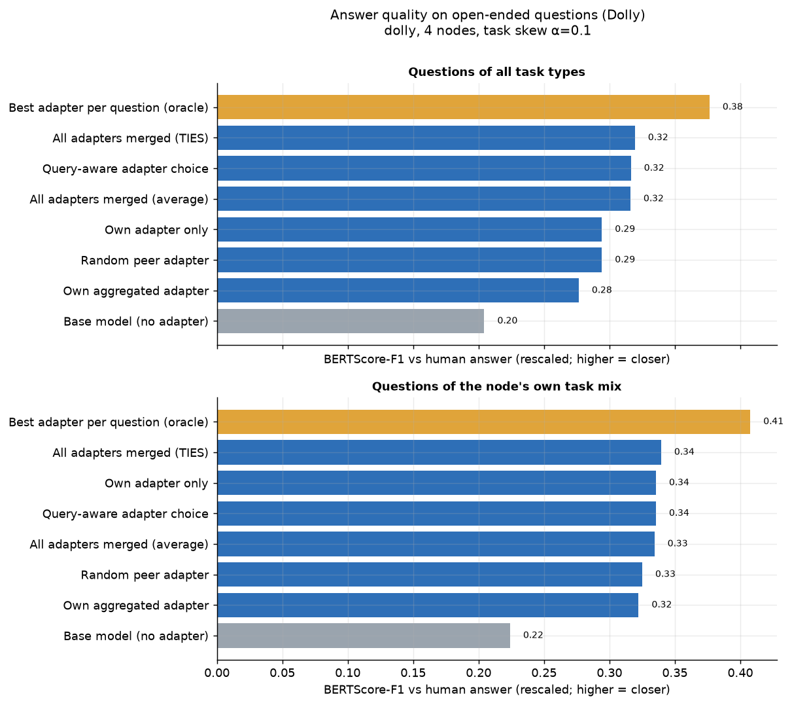
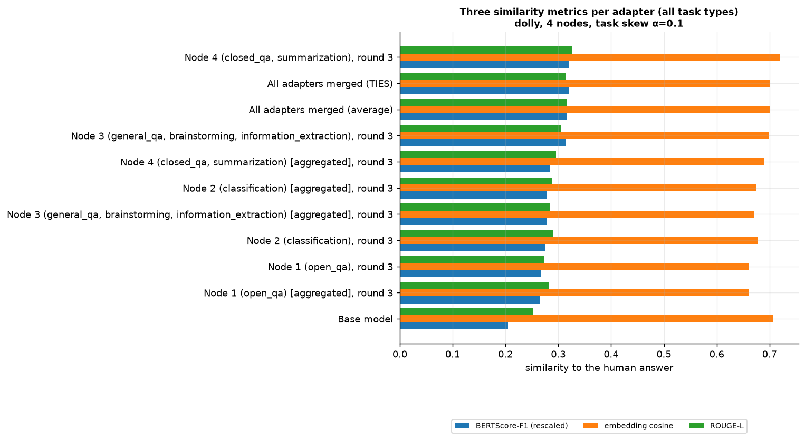

# Results: dolly, 4 nodes, label skew α=0.1, seed 0

Folders: `figures/` (PNG + PDF), `tables/` (the numbers behind every figure, CSV), `raw/` (one row per question or request).

## Open-ended answers: quality of each way of answering

**How to read it.** BERTScore-F1 compares the meaning of the model's answer with the human reference answer (roberta-large, rescaled so 0 = unrelated text; higher is better). Colours as in accuracy_by_selection_method.

**What this run shows.** All task types: own adapter 0.294, base 0.204, query-aware 0.316, merged 0.316, oracle 0.376.
Table: `tables/generation_quality_by_method.csv`

## Do the similarity metrics agree?

**How to read it.** Three ways to compare an answer with the reference: BERTScore-F1 (meaning, token level, rescaled), cosine of sentence embeddings (topic of the whole answer), ROUGE-L (shared word sequences).

**What this run shows.** Rank agreement with BERTScore across adapters (Spearman): ROUGE-L 0.95, embedding cosine 0.55. Embedding cosine rates the base model 0.71, close to the best adapters, because it measures whether the answer is on topic, not whether it matches the reference style and content; use BERTScore and ROUGE-L for quality claims.

