# System One decisions: ag_news (4 options), 4 nodes, label skew α=0.1, seed 0

Model Qwen2.5-1.5B-Instruct; adapters trained on the decision prompt; the node scores the raw System One prompt (federated_inference/system_one.py). Folders: `figures/`, `tables/`, `raw/`.

## Accuracy of each way of deciding
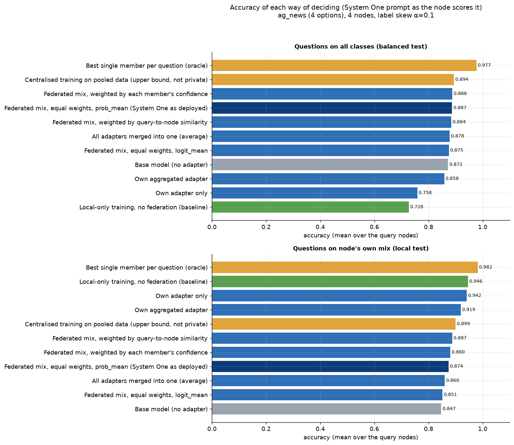

**How to read it.** Each bar is one way to make the decision: base model, the node's own adapter, the federated System One mix of all nodes' adapters (dark blue = as deployed: equal weights, prob_mean, all cyclic orderings) and other mixing variants, training baselines (green), upper bounds (orange). Top: all classes; bottom: the node's own class mix.

**What this run shows.** All classes: base 0.872, own adapter 0.758, federated mix 0.887, centralised 0.894, oracle member 0.977. Own mix: own adapter 0.942, federated mix 0.874.

## How good are the probabilities?
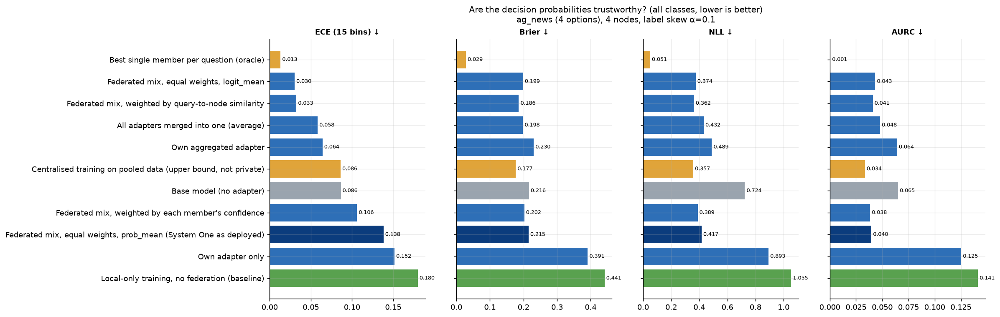

**How to read it.** ECE: gap between confidence and accuracy (15 equal-width bins). Brier and NLL: proper scores of the full distribution. AURC: area under the risk-coverage curve (how well confidence ranks right above wrong answers).

**What this run shows.** Federated mix: ECE 0.138, Brier 0.215, AURC 0.040; own adapter: ECE 0.152, AURC 0.125; base: ECE 0.086.

## Does the deployed prompt format match how adapters were trained?
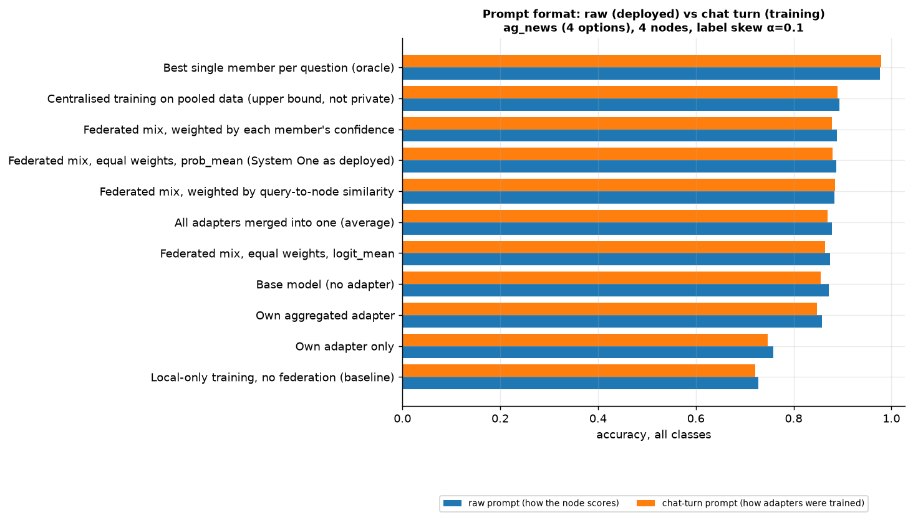

**How to read it.** The node scores the raw System One prompt (next token after 'Answer:' is ' A'); the adapters were trained with the same prompt inside a chat turn (next token 'A').

**What this run shows.** Mean absolute accuracy difference raw vs chat over methods: 0.008.

## Reliability diagrams
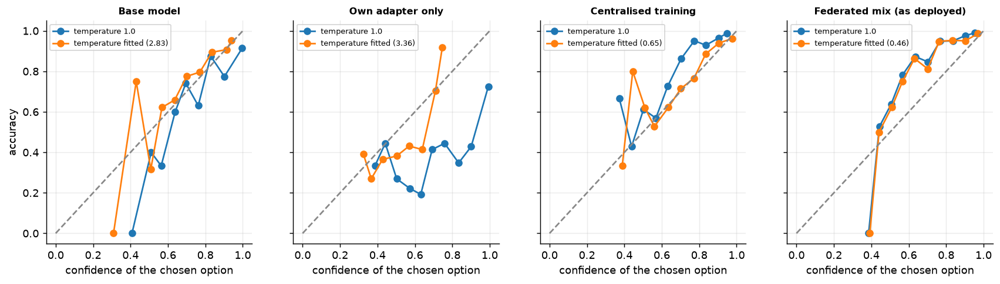

**How to read it.** Accuracy vs confidence in 15 equal-width bins (all classes, query node 1). On the dashed diagonal a 70% confident answer is right 70% of the time. Temperature fitted on the validation split by NLL.

**What this run shows.** Points above the diagonal mean the model is under-confident (right more often than it claims), below it over-confident. ECE/NLL before and after the fitted temperature are in decision_calibration_temperature.csv.

## Does fitting the calibration temperature help?
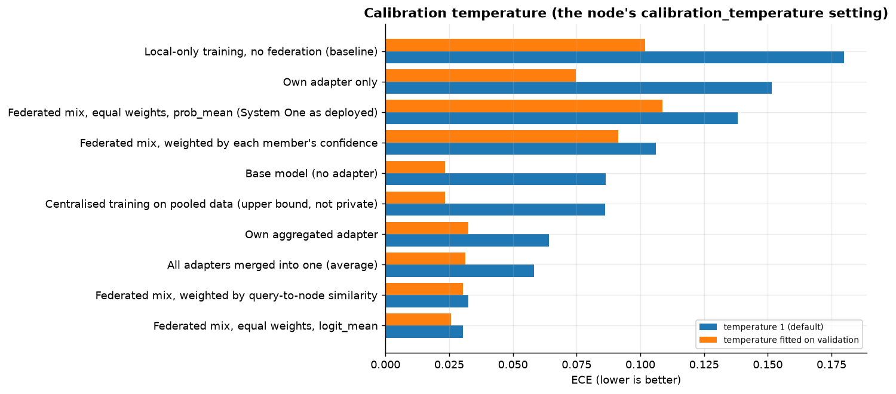

**How to read it.** System One divides the option logits by calibration_temperature. Fitting it on 400 validation decisions (NLL) vs leaving it at 1.

**What this run shows.** Federated mix: fitted T=0.46, ECE 0.138 -> 0.109, accuracy unchanged (0.887 -> 0.882).

## Selective prediction: answering only when confident
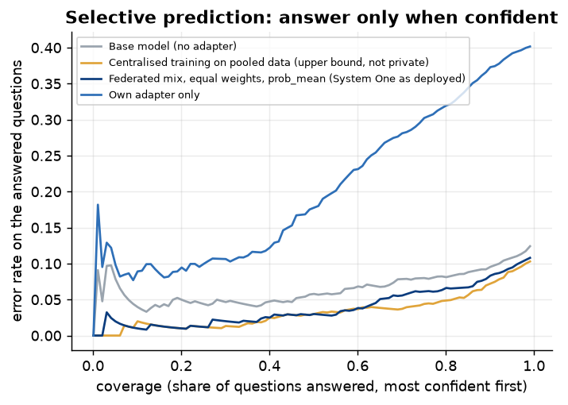

**How to read it.** Risk-coverage curves: keep the most confident decisions, defer the rest. Lower curve = confidence ranks right answers above wrong ones better.

**What this run shows.** Federated mix accuracy: 0.887 on all, 0.935 on the most confident 80%, 0.972 on the most confident 50%.

## Reordering the options: bias and the cost of removing it
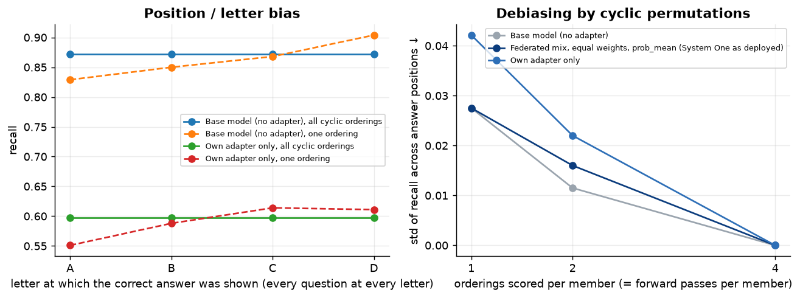

**How to read it.** Every question is scored with its correct answer at every letter, so class difficulty cancels out. Left: accuracy by the letter the correct answer was shown at, scoring one ordering (dashed) vs averaging all cyclic orderings (solid; position-independent by construction). Right: spread of that accuracy across letters (Zheng et al., ICLR 2024) vs orderings scored = forward passes per adapter.

**What this run shows.** With one ordering the chosen answer changes under reordering for 13.1% (base) and 21.5% (own adapter) of questions. Recall spread for the federated mix: 0.028 (1 ordering) -> 0.000 (all).

## How many adapters should a decision mix?
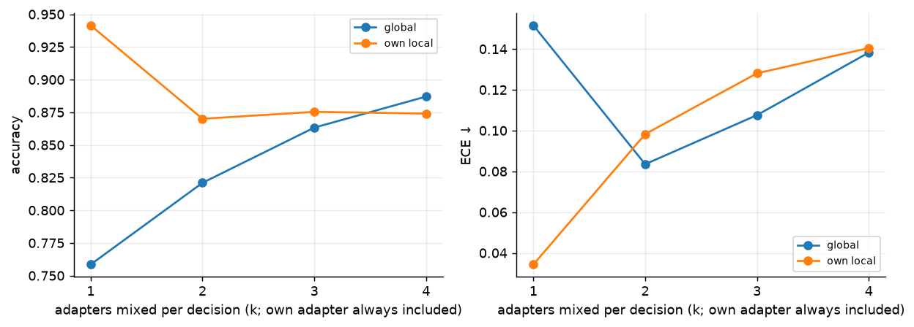

**How to read it.** Accuracy and calibration as more peers' adapters join the node's own (averaged over every choice of peers).

**What this run shows.** All classes: k=1 0.758, k=2 0.821, k=4 0.887; each extra member costs one more forward pass per ordering (see decision_latency_vs_members).

## Decisions with poisoned peer adapters
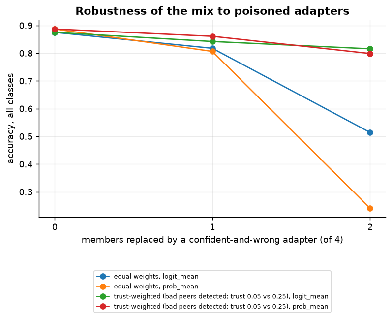

**How to read it.** A peer's adapter is replaced by one that puts 97% on a wrong option. prob_mean averages the members' probabilities; logit_mean averages their log-probabilities (geometric mean). 'Trust-weighted' assumes trust has flagged the bad peer (0.05 vs 0.25), weights = softmax(trust / 0.1) as in the node.

**What this run shows.** Equal weights, prob_mean: 0.887 -> 0.806 (1 bad) -> 0.241 (2 bad); logit_mean: 0.875 -> 0.818 -> 0.514.

## Agreement between members vs accuracy
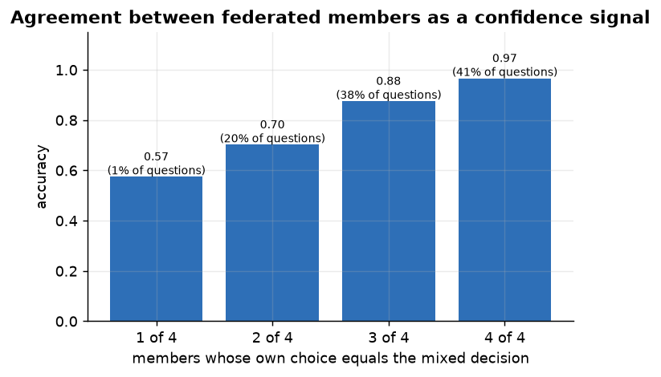

**How to read it.** Decisions grouped by how many of the 4 members chose the same option as the mix (the 'agreement' field the node returns).

**What this run shows.** 1 of 4 agree: accuracy 0.57 on 1% of questions; 2 of 4 agree: accuracy 0.70 on 20% of questions; 3 of 4 agree: accuracy 0.88 on 38% of questions; 4 of 4 agree: accuracy 0.97 on 41% of questions

## Format mass: probability put on the option letters
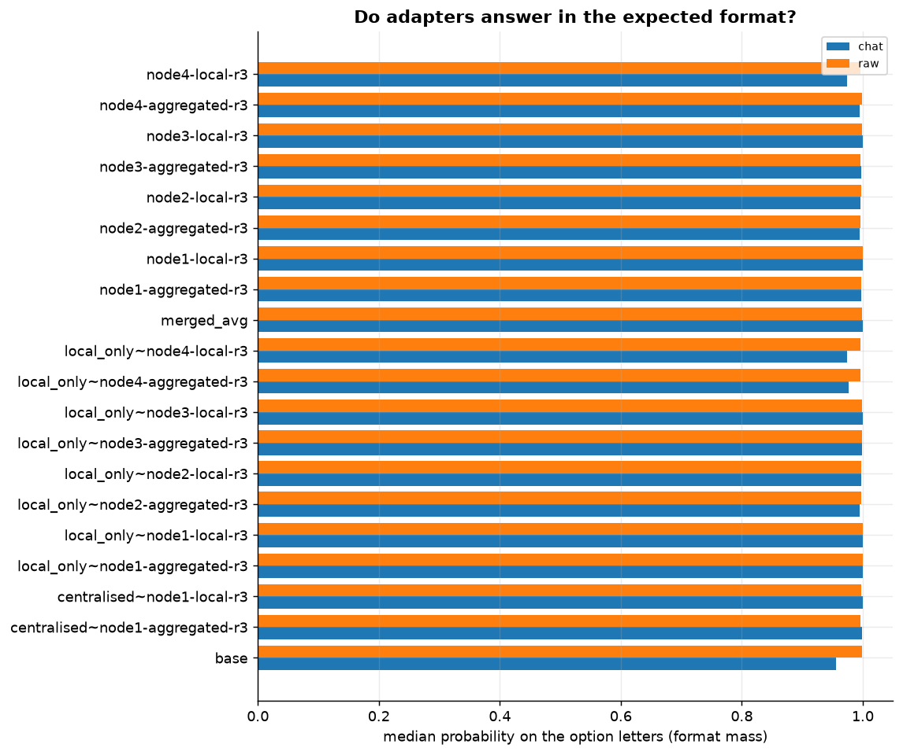

**How to read it.** Share of the next-token probability that falls on the valid option letters before System One restricts to them. Low values mean the probabilities are renormalised from a small, unreliable remainder.

**What this run shows.** Lowest median format mass: 0.955 (base, chat).

## Shortcut check: options without the text
**How to read it.** Accuracy when the text is withheld and only the options are shown. Every question then becomes the same prompt, so a model gives one answer to all of them, which is exactly chance on a balanced test: the check confirms the decisions come from the text, not from the options alone.

**What this run shows.** Text withheld: 0.250-0.250 (chance 0.250) vs 0.534-0.894 with the text.

## Deciding vs generating
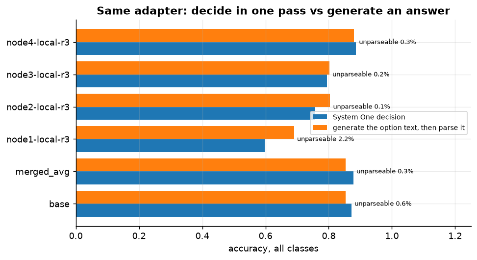

**How to read it.** The same adapters answer either as a System One decision (probabilities over the options) or by generating the option text, which is then matched to the options.

**What this run shows.** Mean accuracy: decide 0.797, generate 0.814; unparseable generated answers 0.6%; a decision can never be unparseable.

## Latency of one federated decision
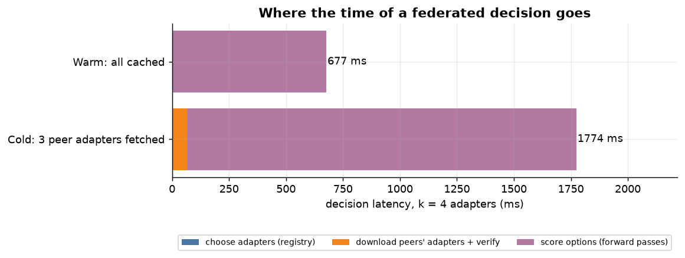

**How to read it.** A k=4 decision: choose adapters from the local registry, download the missing ones by hash (concurrently), then one forward pass per adapter per option ordering on the node's GPU.

**What this run shows.** Cold 1774 ms (download 64 ms) vs warm 677 ms (16 forward passes, 636 ms of model time).

## Latency vs adapters mixed
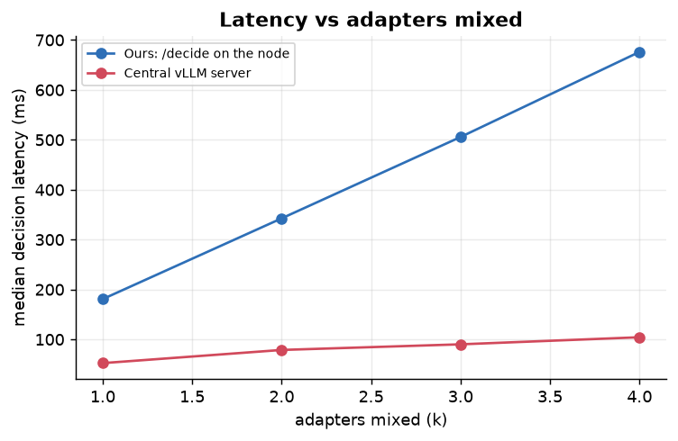

**How to read it.** Median end-to-end latency of warm decisions, one at a time.

**What this run shows.** Ours (adapters mixed (k)) - 1: 181 ms, 2: 343 ms, 3: 506 ms, 4: 676 ms.

## Latency vs orderings
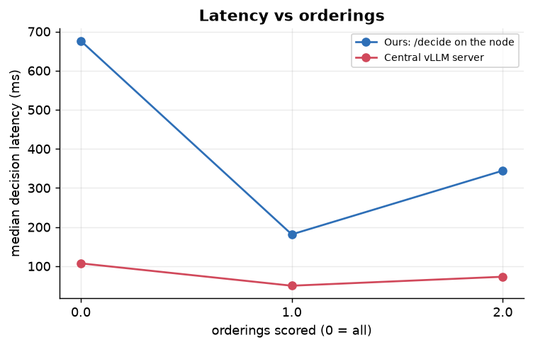

**How to read it.** Median end-to-end latency of warm decisions, one at a time.

**What this run shows.** Ours (orderings scored (0 = all)) - all: 676 ms, 1: 181 ms, 2: 344 ms.

## Latency vs number of options
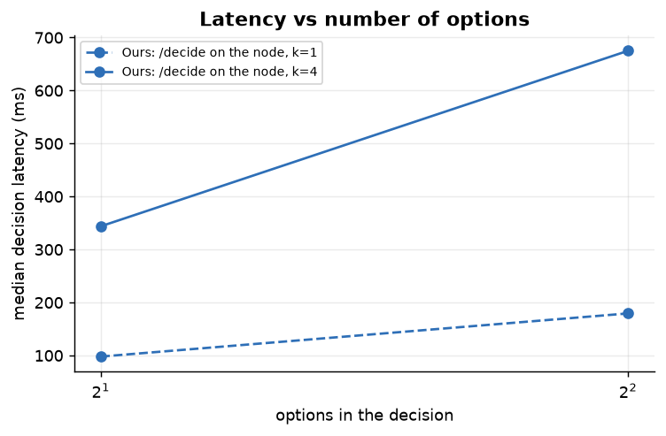

**How to read it.** Median end-to-end latency of warm decisions, one at a time.

**What this run shows.** Ours (options in the decision) - k=1: 2 options 98 ms, 4 options 179 ms; k=4: 2 options 344 ms, 4 options 675 ms.

## Many decisions at once: our node vs a central server
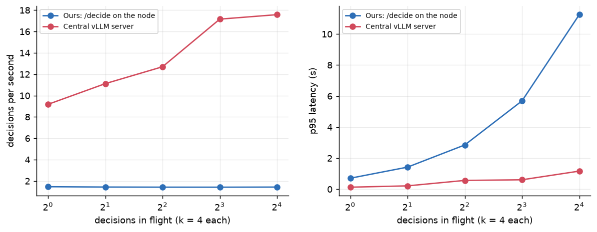

**How to read it.** k=4 decisions sent concurrently to one node (ours) or one vLLM server holding the same adapters.

**What this run shows.** Ours: /decide on the node at 16 in flight: 1.4/s; Central vLLM server at 16 in flight: 17.6/s.

## Determinism
**How to read it.** The same k=4 decision requested 50 times.

**What this run shows.** Largest probability difference to the first answer: 0.00e+00; chosen option identical in 100% of repeats.

## Decisions when peers fail
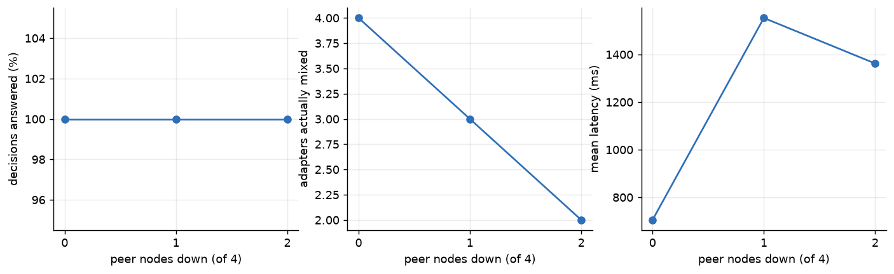

**How to read it.** k=4 decisions while peers are killed (caches emptied first): a dead peer's adapter is dropped from the mix.

**What this run shows.** 0 down: 100% answered with 4.0 members, accuracy 0.900, 705 ms; 1 down: 100% answered with 3.0 members, accuracy 0.900, 1553 ms; 2 down: 100% answered with 2.0 members, accuracy 0.867, 1362 ms.
