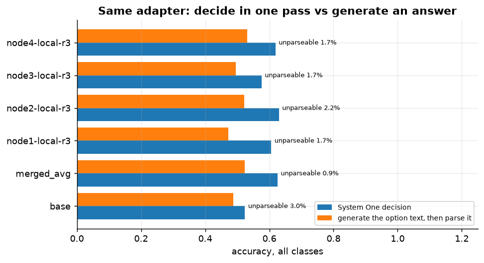
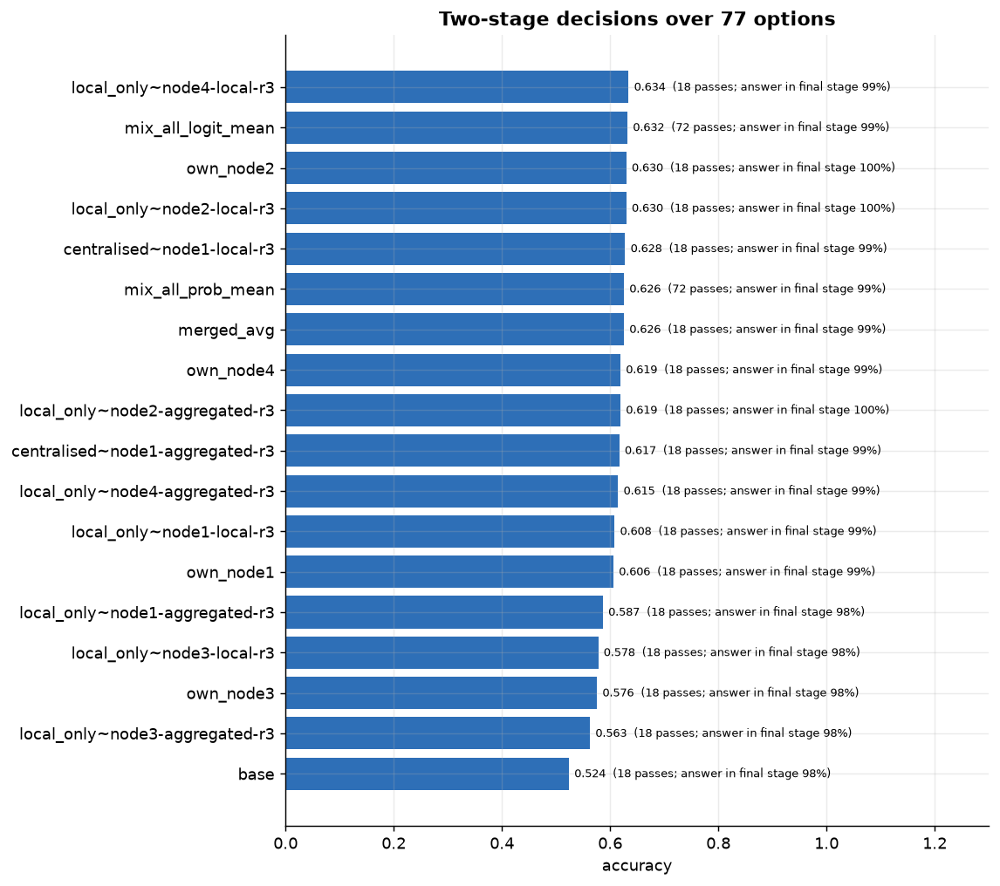
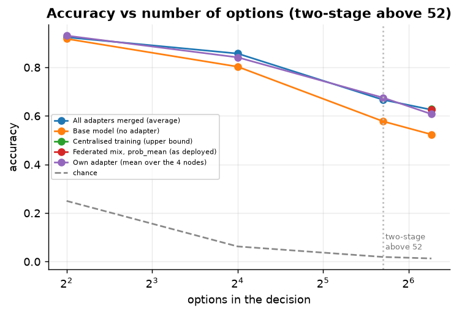
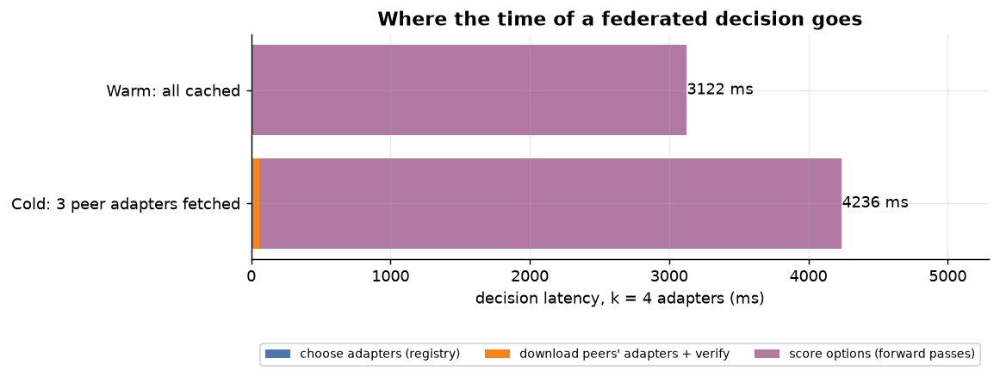
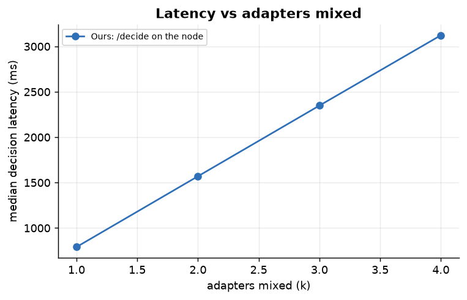
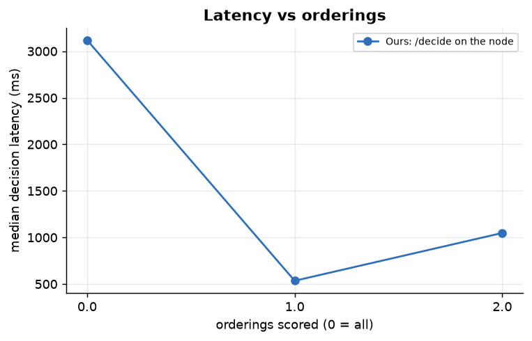
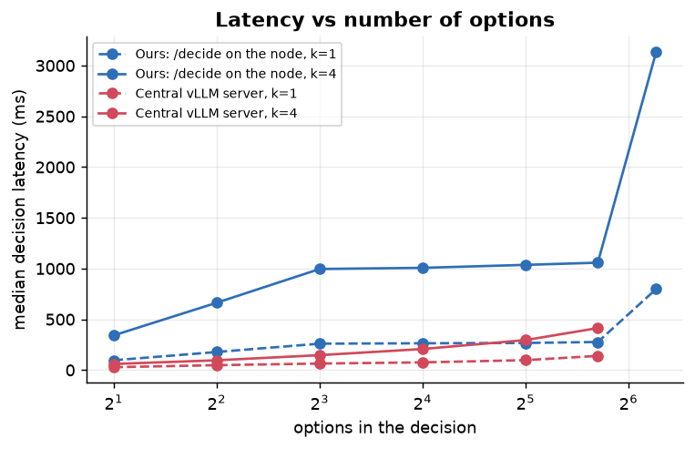
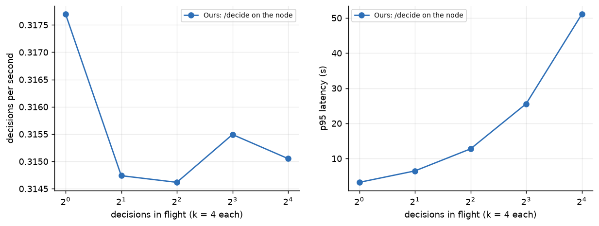
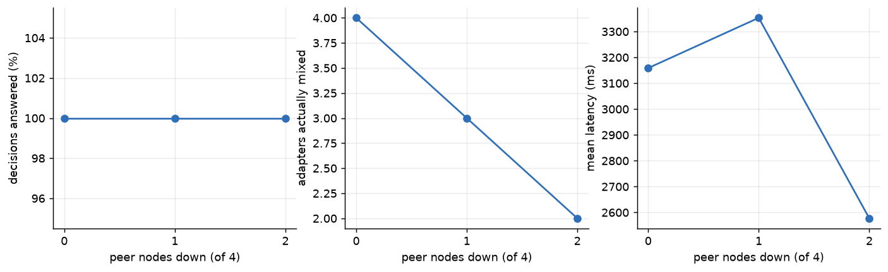

# System One decisions: banking77 (77 options), 4 nodes, label skew α=0.1, seed 0

Model Qwen2.5-1.5B-Instruct; adapters trained on the decision prompt; the node scores the raw System One prompt (federated_inference/system_one.py). Folders: `figures/`, `tables/`, `raw/`.

## Deciding vs generating

**How to read it.** The same adapters answer either as a System One decision (probabilities over the options) or by generating the option text, which is then matched to the options.

**What this run shows.** Mean accuracy: decide 0.597, generate 0.505; unparseable generated answers 1.9%; a decision can never be unparseable.

## Many options: the two-stage path

**How to read it.** More options than single-token labels: options are scored in chunks, the mixed best of each chunk go to a final round. 'Answer in final stage' = how often the correct option survived the first stage.

**What this run shows.** Federated mix 0.626 vs base 0.524; 72 forward passes per mixed decision.

## Accuracy vs number of options

**How to read it.** Same questions, random option subsets that always contain the answer; the largest point uses the two-stage path.

**What this run shows.** Mean accuracy over members: 4 options 0.924, 16 options 0.834, 52 options 0.640, 77 options 0.602.

## Latency of one federated decision

**How to read it.** A k=4 decision: choose adapters from the local registry, download the missing ones by hash (concurrently), then one forward pass per adapter per option ordering on the node's GPU.

**What this run shows.** Cold 4236 ms (download 61 ms) vs warm 3122 ms (72 forward passes, 2915 ms of model time).

## Latency vs adapters mixed

**How to read it.** Median end-to-end latency of warm decisions, one at a time.

**What this run shows.** Ours (adapters mixed (k)) - 1: 791 ms, 2: 1570 ms, 3: 2349 ms, 4: 3123 ms.

## Latency vs orderings

**How to read it.** Median end-to-end latency of warm decisions, one at a time.

**What this run shows.** Ours (orderings scored (0 = all)) - all: 3119 ms, 1: 535 ms, 2: 1048 ms.

## Latency vs number of options

**How to read it.** Median end-to-end latency of warm decisions, one at a time.

**What this run shows.** Ours (options in the decision) - k=1: 2 options 97 ms, 4 options 178 ms, 8 options 260 ms, 16 options 264 ms, 32 options 267 ms, 52 options 277 ms, 77 options 798 ms; k=4: 2 options 342 ms, 4 options 664 ms, 8 options 996 ms, 16 options 1007 ms, 32 options 1036 ms, 52 options 1058 ms, 77 options 3131 ms.

## Many decisions at once: our node vs a central server

**How to read it.** k=4 decisions sent concurrently to one node (ours) or one vLLM server holding the same adapters.

**What this run shows.** Ours: /decide on the node at 16 in flight: 0.3/s.

## Determinism
**How to read it.** The same k=4 decision requested 50 times.

**What this run shows.** Largest probability difference to the first answer: 0.00e+00; chosen option identical in 100% of repeats.

## Decisions when peers fail

**How to read it.** k=4 decisions while peers are killed (caches emptied first): a dead peer's adapter is dropped from the mix.

**What this run shows.** 0 down: 100% answered with 4.0 members, accuracy 0.700, 3159 ms; 1 down: 100% answered with 3.0 members, accuracy 0.633, 3353 ms; 2 down: 100% answered with 2.0 members, accuracy 0.633, 2577 ms.
